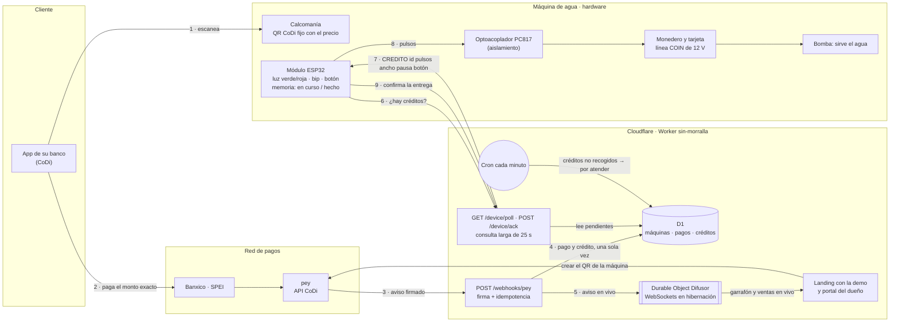

<p align="center">
  
</p>

<p align="center"><b>Tu máquina de siempre, ahora sin monedas.</b><br>
Un módulo que conecta las máquinas de monedas a CoDi: el pago con QR se convierte en los pulsos del monedero.</p>

<p align="center">
  <a href="https://sin-morralla.victormlaralopez.workers.dev"><b>Demo en vivo</b></a> ·
  <a href="https://sin-morralla.victormlaralopez.workers.dev/portal/">Portal del dueño</a> ·
  <a href="#pruébalo">Pruébalo</a> ·
  <a href="#cómo-funciona-por-dentro">Diagrama</a> ·
  <a href="firmware/README.md">Firmware</a> ·
  Hackatón México 2026
</p>

| Estado | |
|---|---|
| Software | Desplegado en Cloudflare (Worker, D1, Durable Object y cron). 34 pruebas unitarias, 30 de punta a punta y 8 de la lógica del firmware en verde |
| Pagos CoDi | QR fijo creado con el API de pey y probado con dos pagos reales al mismo QR (23 de noviembre de 2026) |
| Demo pública | Lista. Muestra su QR real de $1 en cuanto la cuenta de pey del proyecto termina su activación |
| Hardware | Firmware escrito; su lógica de entrega se prueba en la PC y el protocolo con el simulador. Falta la prueba en placa con un monedero real |

---

## Qué es

En México hay miles de **despachadores de agua purificada** en las colonias y casi todos funcionan **solo con
monedas**. Cada vez menos gente trae morralla: el cliente que no trae monedas se va, y el dueño pierde la venta.
Cambiar la máquina por una con terminal es caro, y las terminales cobran comisión por cada venta.

**Sin Morralla** es un módulo pequeño (un ESP32 y un optoacoplador) que se conecta **en paralelo** al monedero que la
máquina ya tiene. En la máquina se pega una **calcomanía con un QR CoDi fijo** que ya trae el precio. El cliente:

1. Abre la app de su banco, entra a CoDi y escanea la calcomanía.
2. Revisa el nombre del dueño y el monto, y paga.
3. En segundos la luz parpadea, suena un bip y **la máquina sirve**, porque el módulo le manda los mismos pulsos que
   mandaría una moneda.

La máquina no se modifica, las monedas siguen funcionando y, si un día se quita el módulo, todo queda como estaba.

**Para el dueño** hay un portal con las ventas CoDi del día en vivo, el estado de cada máquina (en línea o no), la
configuración del precio y de los pulsos, la calcomanía lista para imprimir y una lista de **pagos por atender**: los
que la máquina no pudo servir, para devolverlos desde su banco si el cliente lo pide.

**Reglas de cobro pensadas para la calle.** CoDi no da cambio: el QR trae el precio exacto y lo que se pague de más
nunca se devuelve en monedas. Así nadie puede vaciar el cambio de la máquina pagando con CoDi. Un pago se sirve **una
sola vez**, aunque pey repita el aviso o el módulo se reinicie a media entrega, y ningún pago se pierde: si no se
sirvió, aparece en el portal.

**Por qué CoDi y pey.** CoDi no tiene comisión para el cliente, todos los bancos lo tienen en su app y el dinero llega
por SPEI con su clave de rastreo. Con el API de pey creamos un QR fijo por máquina (`POST /codi/qr` con
`expiration: 0`) y recibimos cada pago por webhook. El 23 de noviembre comprobamos que **un mismo QR fijo acepta
varios pagos**, que era la hipótesis que hacía posible poner una calcomanía en lugar de una pantalla.

**La demo** de la landing es una máquina virtual con su propio QR real de $1: quien paga desde su banco ve cómo se
llena un garrafón en la página, en vivo, con el mismo camino que usaría una máquina real.

## Un cobro real

El 23 de noviembre de 2026 creamos con el API de pey un **QR fijo de $0.01 sin vencimiento** y lo pagamos **dos veces**
desde una app bancaria. Las dos operaciones se aceptaron (comisión $0.00, el banco mostró el nombre del beneficiario) y
el portal de pey registró **dos transacciones exitosas** de tipo `API_CODI_QR` para el mismo QR:

| Transacción en pey | Monto |
|---|---|
| `01M85BYRNG6FAVQ1ASPHTRJ2M7` | $0.01 |
| `01M85C200V0W5583JZB5WSC8S6` | $0.01 |

El detalle de la prueba y de las hipótesis del MVP está en [docs/MVP.md](docs/MVP.md) (H2).

## Uso del API de pey

| Endpoint o evento | Qué hace en Sin Morralla | Archivo |
|---|---|---|
| `POST /codi/qr` | Crea el QR fijo de cada máquina: con el precio exacto o con monto 0 si la máquina tiene varios llenados; `expiration: 0` y `metadata.maquina` | [src/worker/pey.ts](src/worker/pey.ts) |
| Webhook `codi.qr.payment_received` | Avisa cada pago. Se verifica la firma (Standard Webhooks), se identifica la máquina por el IDC del QR y se registra pago y crédito en una sola transacción | [src/worker/webhook.ts](src/worker/webhook.ts), [src/core/firma.ts](src/core/firma.ts) |
| Webhook `codi.pn.payment_received` | Se acepta y se registra (cobros enviados al celular), aunque el MVP solo usa QR | [src/core/pagos.ts](src/core/pagos.ts) |

## Cómo funciona por dentro

Un solo diagrama con el servicio, el flujo de un pago y el hardware. Los números siguen el recorrido de un pago.



**Qué pasa en cada paso**

1. **El cliente escanea** la calcomanía con la app de su banco. El QR ya trae el precio (o monto libre).
2. **Paga.** CoDi mueve el dinero por SPEI a la cuenta del dueño, sin comisión para el cliente.
3. **pey avisa al Worker** con un webhook firmado. El Worker verifica la firma HMAC con el secreto de pey (rechaza
   firmas inválidas o avisos de más de 5 minutos) y lee el monto, el IDC del QR y la clave de rastreo.
4. **Registro único.** Pago y crédito se guardan en una sola transacción de D1 con el `transactionId` como llave: si pey
   reintenta o repite el aviso, no se crea un segundo crédito. El crédito se calcula con el precio y el valor del pulso
   de la máquina: si alguien paga menos que el precio, el pago queda **por atender** en lugar de servirse.
5. **En vivo.** El Durable Object `Difusor` reparte el evento a la landing (canal `demo`) y al portal (canal `portal`)
   con WebSockets en hibernación: mientras nadie habla, no consume.
6. **El módulo pregunta** con una consulta larga de hasta 25 s; el Worker revisa D1 cada segundo y responde en cuanto
   hay crédito, así que la máquina reacciona en 1 a 2 segundos sin mantener nada despierto.
7. **El Worker responde** una línea de texto con el crédito, el ancho y la pausa del pulso, y si hay que esperar el
   botón "Servir con CoDi".
8. **El módulo da los pulsos.** Antes de darlos guarda el crédito como *en curso* y después como *hecho*, en memoria no
   volátil. El optoacoplador cierra la línea COIN igual que una moneda y la tarjeta de la máquina enciende la bomba.
9. **Confirma la entrega.** Si se perdió la confirmación, el Worker vuelve a mandar el crédito, el módulo lo reconoce
   como *hecho* y solo confirma. Si se fue la luz a media entrega, no repite pulsos: confirma como *parcial* y el pago
   aparece en el portal. Un cron vence cada minuto los créditos que ninguna máquina recogió en 10 minutos.

## Pruébalo

### En línea

Abre la **[demo en vivo](https://sin-morralla.victormlaralopez.workers.dev)**. La tarjeta "Demo en vivo" muestra el QR
real de $1 de la máquina virtual:

1. Abre la app de tu banco, entra a CoDi y escanea el QR (o usa **Descargar QR** y ábrelo desde la app si estás en el
   celular).
2. Revisa el beneficiario y el monto de **$1.00**, y paga. Es un pago real a la cuenta del proyecto.
3. En segundos la página dice "¡Pago recibido!", la máquina recibe su pulso y **el garrafón se llena**. El contador de
   pagos de hoy sube para todos los que tengan la página abierta.

> Mientras la cuenta de pey del proyecto termina su activación, la tarjeta dice "La demo se está preparando". En ese
> caso usa la prueba local: es el mismo código y el mismo camino del aviso.

### En tu computadora (3 minutos)

Requisitos: Node.js 22.18 o más reciente.

```bash
git clone https://github.com/VictorLaraL/sin-morralla.git
cd sin-morralla
npm install
cp .dev.vars.example .dev.vars    # modo SIMULACION=1: no necesita llaves de pey
npm run dev                        # http://localhost:8787
```

- **Landing:** abre <http://localhost:8787> y presiona **Simular pago de $1**. El botón manda un aviso **firmado** al
  mismo `/webhooks/pey` que usa pey, así que recorre el camino completo: firma, D1, Durable Object y garrafón. En modo
  local todo lo simulado dice **SIMULADO**.
- **Portal:** abre <http://localhost:8787/portal/> con la clave `PORTAL_TOKEN` de tu `.dev.vars`. Ahí puedes crear el
  QR (simulado en local), cambiar el precio, generar el token del módulo, mandar un pulso de prueba e imprimir la
  calcomanía.
- **Una máquina simulada:** genera el token del módulo en el portal y en otra terminal corre
  `npm run simular:maquina -- --token <token>`. Luego manda un pago a su QR con
  `npm run simular:pago -- --qr <IDC del QR> --monto 13`: la máquina simulada recibe 13 pulsos y confirma.
- **Pruebas:**

```bash
npm test          # 34 pruebas unitarias: firma, lectura del aviso, pulsos, validaciones, boletos
npm run e2e       # 30 pruebas de punta a punta contra npm run dev (en otra terminal)
npm run typecheck # tipos de TypeScript contra los bindings de Cloudflare
npm run test:firmware  # 8 pruebas de la entrega en dos fases del ESP32 (necesita g++, clang++ o Visual Studio Build Tools)
```

Las pruebas de punta a punta cubren, entre otras cosas: avisos sin firma rechazados, un pago que llega dos veces y se
sirve una, la consulta larga que entrega en segundos, pagos menores al precio que no dan servicio, el ACK de un crédito
ajeno, créditos que vencen y aparecen por atender, entregas interrumpidas y cómo se cierran, el WebSocket del portal
con boleto y el límite del formulario de contacto.

### Con hardware

Las conexiones, el protocolo y los pasos para cargar el ESP32 están en [firmware/README.md](firmware/README.md). La
lista de compras y el banco de pruebas (monedero de 12 V y bomba) están en [docs/hardware-mvp.md](docs/hardware-mvp.md).

## Seguridad y reglas de cobro

| Riesgo | Cómo se cubre |
|---|---|
| Avisos de pago falsos | Firma HMAC-SHA256 de Standard Webhooks con comparación en tiempo constante; ventana de 5 minutos; cuerpo de máximo 64 KB |
| Servir dos veces un pago | `transactionId` como llave única; pago y crédito en un solo batch de D1; el módulo guarda *en curso* y *hecho* |
| Vaciar el cambio de la máquina | CoDi nunca devuelve monedas; lo pagado de más queda anotado, no se entrega |
| Pagos que no se sirven | Vencen a los 10 minutos y aparecen en "Pagos por atender" con su clave de rastreo |
| Un módulo robado o clonado | Token por máquina guardado como SHA-256; se cambia desde el portal y el anterior deja de servir |
| Clave del portal expuesta | Solo viaja en el encabezado `Authorization`; el WebSocket usa un boleto firmado de 60 s |
| Calcomanía pegada encima | La calcomanía pide verificar el nombre del beneficiario que muestra el banco antes de pagar |
| Datos de interesados | El portal pinta todo como texto (sin HTML); el formulario tiene campo trampa y límite de 5 envíos por hora por huella de IP |

## Arquitectura y código

Todo corre en una cuenta de Cloudflare: **Worker** con archivos estáticos, **D1** (SQLite), un **Durable Object**,
**cron** y **secretos**. Sin servidores que administrar.

| Ruta | Qué hay |
|---|---|
| [src/core/](src/core) | Lógica pura, sin Cloudflare, con pruebas: firma de avisos, lectura del pago, cálculo de pulsos, protocolo del módulo, validaciones, tokens y boletos |
| [src/worker/](src/worker) | El Worker: webhook de pey, API del módulo, API pública de la demo, API del portal, difusor en vivo y cron |
| [migrations/](migrations) | Esquema de D1 |
| [web/](web) | Landing con la demo, portal del dueño y dibujo del QR (sin frameworks) |
| [firmware/](firmware) | Módulo ESP32 |
| [herramientas/](herramientas) | Simuladores de pago y de máquina, y las pruebas de punta a punta |
| [docs/](docs) | MVP, plan, hardware, investigación de mercado y prospectos |
| [odd/tasks/](odd/tasks) | Bitácora del desarrollo: especificación, tareas, evidencia de pruebas y revisiones |

**Cómo se construyó.** Cada tarea empezó con pruebas que fallaban (RED) antes del código (GREEN). Cada tramo de commits
pasó por una revisión de riesgo, confiabilidad y resiliencia con gentle-ai; las advertencias se atendieron con pruebas
en commits propios. La bitácora con citas, evidencia y resultados está en
[odd/tasks/sin-morralla-mvp.md](odd/tasks/sin-morralla-mvp.md).

### Desplegarlo en tu cuenta

```bash
npx wrangler d1 create sin-morralla          # copia el database_id a wrangler.jsonc
npx wrangler secret put PORTAL_TOKEN         # clave larga para el portal
npx wrangler secret put PEY_API_KEY          # llave del API de pey
npx wrangler secret put PEY_WEBHOOK_SECRET   # secreto whsec_… del webhook en el portal de pey
npm run deploy                               # aplica las migraciones remotas y publica
```

En el portal de pey registra el webhook `https://<tu-worker>.workers.dev/webhooks/pey`. Luego entra al portal de Sin
Morralla, crea el QR de la máquina demo y el de cada máquina, e imprime sus calcomanías.

## Componentes previos

Para cumplir con la declaración de código previo de las bases:

- **Prototipo propio anterior al hackatón** (carpeta `hackaton-mexico-2026`, del mismo autor, no publicada): de ahí se
  adaptaron la idea de la verificación de avisos de pey, el cálculo de pulsos, la primera versión del firmware y los
  simuladores. En este repositorio se reescribieron para Cloudflare (Worker, D1, Durable Object) y se ampliaron.
- **Todo el código de este repositorio** se escribió a partir del 23 de noviembre de 2026. Su historia empieza en el
  commit `f1714e5` (documentación) y `5a8a4f2` (estructura).
- **Terceros:** [qrcode-generator](https://github.com/kazuhikoarase/qrcode-generator) 1.4.4 (MIT, incluido en
  `web/vendor`) para dibujar el QR; `standardwebhooks` solo en pruebas, para comprobar la firma contra la librería
  oficial; Wrangler y TypeScript como herramientas.

## Limitaciones conocidas

- **Hardware sin probar en placa.** La lógica de entrega del firmware se prueba en la PC y su protocolo con el
  simulador, pero falta compilar el sketch completo para el ESP32 y probarlo con un monedero real.
- **La demo pública espera la activación de la cuenta de pey** (hasta 5 días hábiles). Mientras tanto, la prueba local
  recorre el mismo camino con avisos firmados.
- **Un solo cliente.** El portal es de un dueño; la multitenencia es el siguiente paso.
- **QR sin monto sin probar.** Se probó el QR con monto fijo; el de monto libre (para máquinas con varios llenados)
  falta.
- **Sin devoluciones automáticas.** pey no ofrece devoluciones por API: el dueño devuelve desde su banco y lo marca en
  el portal.
- **Certificado sin fijar en el módulo** durante el piloto (ver firmware/README.md).
- **Costo de la consulta larga.** Cada máquina conectada hace una lectura de D1 por segundo (unas 86 mil al día). Para
  una flota grande, el siguiente paso es un Durable Object por máquina que avise al módulo por WebSocket.

## Impacto

- **Para el dueño:** vende a quien no trae monedas, sin cambiar la máquina ni pagar comisión de terminal, y ve sus
  ventas en tiempo real. Menos efectivo que contar, cambiar y cuidar.
- **Para el cliente:** compra agua aunque no traiga morralla, con la app que ya tiene.
- **Para CoDi:** lleva los pagos digitales a un lugar donde hoy solo hay monedas, con un costo de entrada bajo (el
  material del módulo cuesta entre $700 y $1,500 por máquina en el piloto).
- **Escala:** el mismo módulo sirve para cualquier máquina que cuente monedas por pulsos: juegos montables,
  masajeadores, lavanderías y autolavados ([docs/prospectos-segmentos.md](docs/prospectos-segmentos.md)).

## Siguientes pasos

1. Probar el módulo en el banco de pruebas con un monedero de 12 V y ajustar el ancho del pulso.
2. Piloto en un despachador de agua real con un dueño que ya aceptó probarlo.
3. Probar el QR sin monto y el modo de crédito acumulado con botón.
4. Multitenencia: un portal por dueño y una cuenta de pey por dueño.
5. Configurar el WiFi del módulo desde el celular y fijar el certificado del servidor.

## Equipo

[VictorLaraL](https://github.com/VictorLaraL)

## Licencia

Todos los derechos reservados. El código es público para la evaluación del hackatón.

CoDi® es una marca registrada de Banco de México. Sin Morralla no está afiliado a Banco de México.
