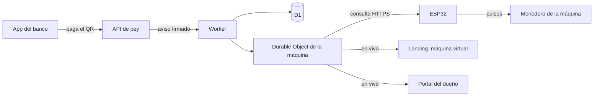

# Sin Morralla — Plan de software

**23 de noviembre de 2026** · **Estado:** propuesta para aprobar antes de codificar.
Documentos relacionados: [MVP.md](MVP.md) · [hardware-mvp.md](hardware-mvp.md).

---

## 1. Meta de esta semana (24–30 de noviembre)

Al cerrar la semana debe estar listo:

1. **Repositorio público** `VictorLaraL/sin-morralla` en GitHub.
2. **Todo publicado en tu cuenta de Cloudflare**, con una dirección HTTPS fija.
3. **Landing con demo en vivo:** cualquiera paga $0.01 con CoDi y ve llenarse un garrafón en la página.
4. **Portal del dueño** (un solo cliente): ventas en tiempo real, estado de la máquina, calcomanía para imprimir y
   pulso de prueba.
5. **ESP32 real en el banco de pruebas** entregando agua con un pago CoDi real.

Mientras tanto, tú buscas al dueño de la máquina para el piloto.

## 2. Decisiones

| Tema | Decisión |
|---|---|
| Primer segmento | Despachadores de agua; después expandirnos |
| Infraestructura | **Todo en Cloudflare**, en tu cuenta personal |
| Repositorio | **Público**, en tu cuenta personal de GitHub (VictorLaraL) |
| Clientes | **Uno solo** por ahora (sin multitenencia) |
| Cobro | Una calcomanía por máquina con su QR CoDi fijo |
| Código previo | Reutilizamos y adaptamos el prototipo de `hackaton-mexico-2026` (lógica de pey, verificación de avisos, cálculo de pulsos, firmware y simuladores). Se declara en la entrega, como piden las reglas |

## 3. ¿Se puede montar todo en Cloudflare? Sí

| Pieza | Servicio de Cloudflare | Para qué |
|---|---|---|
| Servidor | **Workers** | Recibe los avisos de pey, atiende al ESP32 y sirve la API |
| Páginas | **Workers static assets** | Landing, demo y portal |
| Tiempo real | **Durable Objects** (uno por máquina) | Cola de créditos, conexión del ESP32, avisos en vivo a la landing y al portal, detección de "sin conexión" |
| Base de datos | **D1** (SQLite) | Máquinas, QR, pagos, créditos, contactos |
| Tareas programadas | **Cron Triggers / alarmas** | Vencer créditos, revisar máquinas desconectadas |
| Llaves | **Secrets** | API key y secreto del webhook de pey |
| Acceso al portal | **Cloudflare Access** | Código por correo para entrar al portal, sin programar un login |

**Por qué encaja:** pey necesita una dirección HTTPS fija para mandar los avisos, y Workers la da desde el primer
deploy (`sin-morralla.<tu-subdominio>.workers.dev`). Los Durable Objects resuelven el tiempo real sin servidores que
mantener. Para empezar alcanza el plan gratuito: un ESP32 que pregunta cada 25 segundos hace unas 3,500 solicitudes al
día, muy por debajo del límite diario gratuito de Workers. Hay que confirmar los límites vigentes al crear la cuenta.
Un dominio propio es opcional y se puede agregar después.



## 4. Qué vamos a construir

### Rutas

| Ruta | Quién la usa | Qué hace |
|---|---|---|
| `/` | Público | Landing con la demo |
| `/api/demo/en-vivo` | Público | Avisos en vivo de la máquina virtual (WebSocket) |
| `/api/contacto` | Público | "Quiero probarlo en mi máquina" |
| `/webhooks/pey` | pey | Verifica la firma, registra el pago una sola vez y crea el crédito |
| `/device/poll`, `/device/ack` | ESP32 | Pide créditos y confirma la entrega (protocolo que ya existe en el firmware) |
| `/device/estado` | ESP32 | Reporta botón presionado y estado |
| `/portal` y `/api/portal/*` | Dueño (con Cloudflare Access) | Panel, configuración, calcomanía, pulso de prueba |

### Base de datos (D1)

`maquinas` · `qrs` (un QR por máquina, con o sin monto) · `pagos` (cada aviso de pey, sin repetidos) · `creditos`
(pulsos pendientes, entregados, vencidos o sin servicio) · `eventos` (conexiones, botón, luz) · `contactos`.

### Landing (primera impresión del jurado)

1. **Encabezado:** "Tu máquina de siempre, ahora sin monedas." y la demo al lado.
2. **Demo en vivo:** una máquina virtual con su QR CoDi real de **$0.01** (antes $1; se bajó para que nadie dude en probarlo). El visitante paga desde su banco y el garrafón
   de la página se llena al llegar el aviso de pago, con "Pago recibido hace 2 s" y un contador de pagos de la demo.
   La página dice claramente que el pago es real.
3. **Cómo funciona:** se enchufa el módulo, se pega la calcomanía, se cobra con CoDi.
4. **Para el dueño:** sin comisión, sin cambiar la máquina, ventas en tiempo real, menos efectivo.
5. **Máquinas compatibles:** agua hoy; después montables, masajeadores y lavanderías.
6. **Seguridad:** verificar el nombre del dueño en la app del banco, sin cambio, luz de estado.
7. **Contacto:** formulario "Quiero probarlo en mi máquina".
8. **Pie:** aviso de que CoDi es marca de Banco de México y que Sin Morralla no está afiliado.

### Portal del dueño (un solo cliente)

- **Hoy:** ventas CoDi del día y de la semana, máquina en línea o no, últimos pagos.
- **Pagos por atender:** sin servicio o vencidos, para devolverlos desde su banco si el cliente lo pide.
- **Máquina:** precio o monto libre, valor y ancho del pulso, pulso de prueba.
- **Calcomanía:** QR listo para imprimir con el nombre del dueño, "verifica el nombre antes de pagar", "sin cambio" y
  teléfono de aclaraciones.

### Firmware (ESP32)

Ya existe el envío de pulsos con confirmación. Falta: luz verde/roja, bip, botón "Servir con CoDi", apuntar a la
dirección del Worker y probarlo en una placa real.

## 5. Identidad visual

> **Hay una identidad v2 aprobada y todavía sin aplicar** (Azul Profundo, Agua Viva, Verde Pulso; Plus Jakarta Sans,
> DM Sans y JetBrains Mono): [docs/marca](marca/README.md). Lo que sigue es la v1, la que hoy usan la landing, el
> portal y la calcomanía.

| Rol | Color | Uso |
|---|---|---|
| Azul Morralla | `#2743A8` | Color principal: botones, títulos, el QR del logo |
| Ámbar Moneda | `#F2A71B` | La moneda; acentos (no para texto sobre blanco) |
| Agua | `#1FB5D6` | Detalles de la línea de agua; el garrafón de la demo |
| Tinta | `#141A2E` | Texto |
| Papel | `#F5F7FB` | Fondos |

- **Tipografías:** Bricolage Grotesque para títulos e Inter para texto (Google Fonts).
- **Logo:** una moneda que contiene el marcador de un QR: la moneda se vuelve cobro digital. Archivos en `brand/`
  (`marca.svg`, `logo.svg`, `logo-negativo.svg`). Antes de imprimir hay que convertir el texto a curvas.

## 6. Repositorio

```
sin-morralla/
  README.md
  docs/            MVP, plan, hardware, investigación y segmentos
  brand/           logo y colores
  apps/worker/     Worker de Cloudflare: rutas, Durable Object, migraciones de D1
  apps/web/        landing, demo y portal (archivos estáticos)
  firmware/esp32/  código del módulo
  herramientas/    pruebas con pey y simuladores
```

**Reglas por ser público:**
- **Nunca** subir llaves ni secretos: van en los Secrets de Cloudflare y en `.dev.vars`, que queda fuera de git.
- **Nunca** subir datos del cliente piloto (nombre, ubicación, CLABE): van en una carpeta `privado/` fuera de git.
- **Licencia:** sin licencia de código abierto por ahora, así el código se puede ver pero no reutilizar. Se puede
  cambiar después.

## 7. Plan de la semana

| Día | Claude | Tú |
|---|---|---|
| **Lun 24** | Crear el repo y la estructura; landing estática con la identidad | Activar pey y hacer las pruebas de la sección 8; iniciar sesión en GitHub y Cloudflare; comprar el hardware |
| **Mar 25** | Worker: verificación de avisos, D1, Durable Object, API del ESP32; primer deploy | Pasar la API key y el secreto del webhook a Cloudflare (sin pegarlos en el chat) |
| **Mié 26** | Demo en vivo de la landing; primeros pagos reales de punta a punta | Pagar la demo desde tu banco y revisar la experiencia |
| **Jue 27** | Portal del dueño con Cloudflare Access; calcomanía imprimible | Probar el portal |
| **Vie 28** | Firmware en el ESP32: luz, bip y botón; banco de pruebas con monedero y bomba | Armar el banco de pruebas |
| **Sáb 29 – Dom 30** | Pulido, "sin conexión", pruebas de fallas | Visitar al dueño si ya lo encontraste |

## 8. Antes de codificar: activar pey y probar

Detalle paso a paso en la sección "Lo que tienes que hacer" del visor del plan. Resumen:

1. **Entrar al portal de pey** (`portal.pey.mx`) con tu cuenta.
2. **Registrar tu CLABE** como cuenta de cobro (persona física). Tarda hasta 5 días hábiles en activarse.
3. **Mientras se activa,** crear una API key ligada a la cuenta de pruebas que publica pey en su documentación.
   Los pagos a esa cuenta no se devuelven: usar solo $0.01.
4. **Correr la prueba del QR fijo** con `herramientas/prueba-qr-pey.ps1`: crea un QR, lo pagas dos veces y el script
   muestra cuántos pagos registró pey. Primero con monto fijo y después sin monto.
5. **Guardar la API key** en tu gestor de contraseñas. No pegarla en el chat ni en el código.
6. **Preguntar a pey** (mentores o soporte): si un QR fijo acepta varios pagos, sus límites de solicitudes, y si
   podemos registrar la CLABE de un cliente en nuestra API key (regla 7.4).

## 9. Riesgos de la semana

| Riesgo | Qué hacemos |
|---|---|
| Tu CLABE tarda en activarse | Probar con la cuenta de pruebas; **antes de abrir la demo al público, cambiar a tu cuenta**, o los pagos se pierden |
| Las cuentas aparecen como "Pendiente" | La de pruebas ya recibe pagos (probado el 23 de noviembre); la tuya se usa cuando pase a activa |
| Durable Objects o D1 se complican | El prototipo actual ya funciona en Node; se puede publicar temporalmente en otro servicio |
| El ESP32 no se conecta por HTTPS | Probar primero en tu WiFi; usar certificados raíz de Cloudflare en el firmware |
| Abuso de la demo pública | Es un cobro real de $0.01; límite de avisos por minuto en la página |
