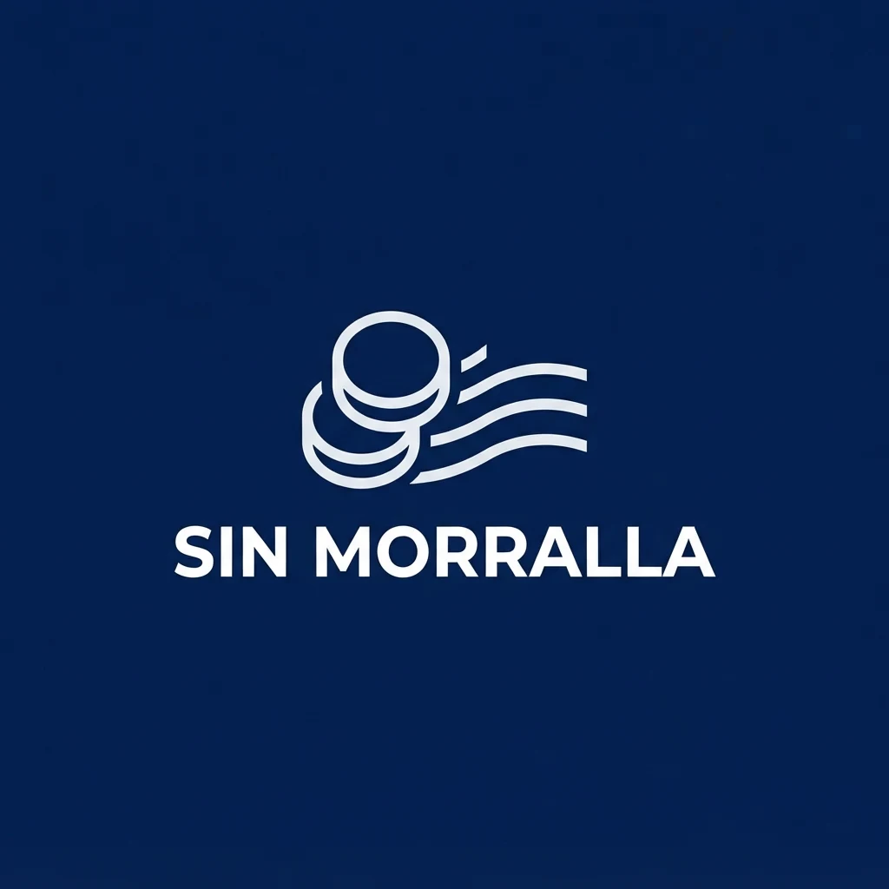
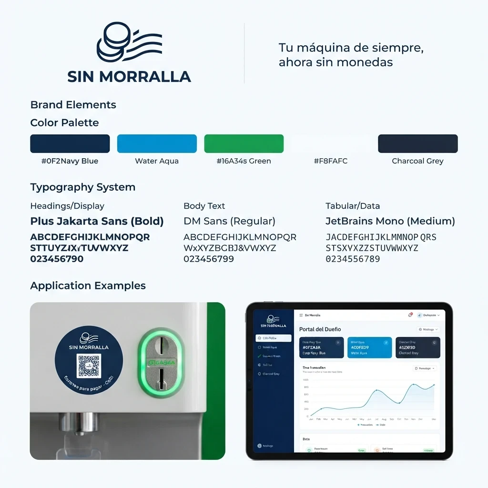
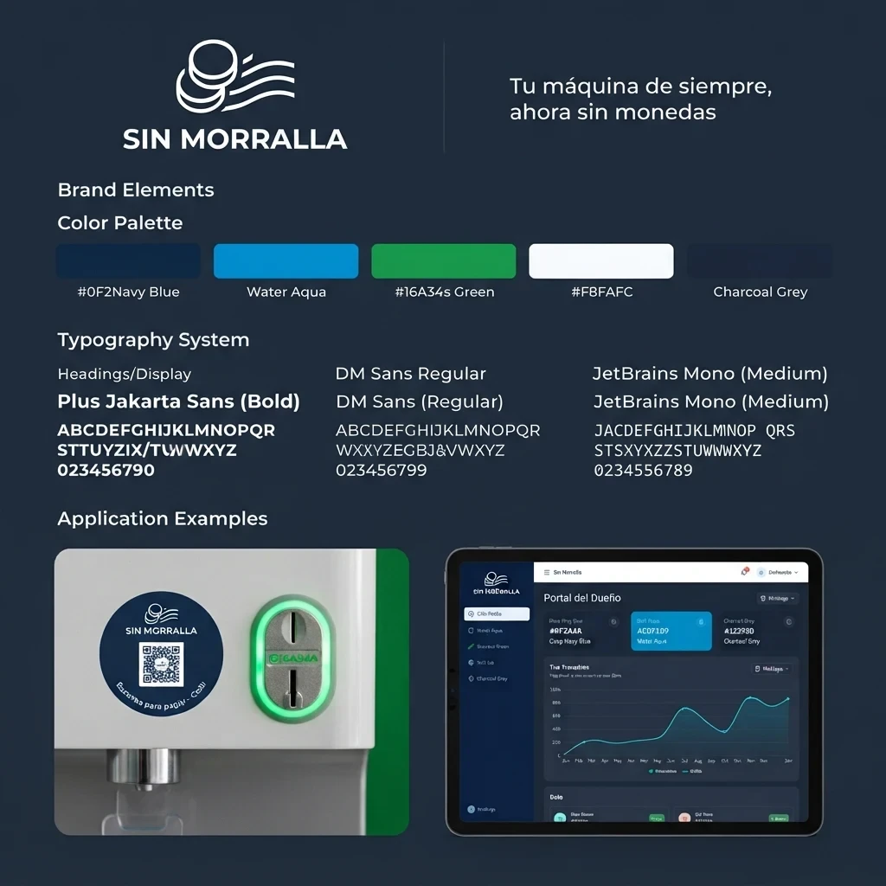

# Sin Morralla — Identidad de marca v2

**25 de noviembre de 2026 · Estado: dirección aprobada, todavía sin aplicar.** La landing, el portal y la calcomanía
siguen con la identidad v1 (Azul Morralla y Ámbar Moneda, en [PLAN.md](../PLAN.md#5-identidad-visual) y en
[`brand/`](../../brand)). La migración está en la sección 7 y se hará cuando se decida.

## 1. Enfoque visual

**Símbolo.** Un ícono geométrico limpio que une el **pulso o señal digital** (la conexión del módulo y el pago
instantáneo) con la idea de **moneda y flujo**. Sin clichés viejos ni dibujos demasiado técnicos. El concepto actual
son dos monedas apiladas de las que salen líneas de flujo: las monedas se vuelven movimiento.

**Logotipo.** "SIN MORRALLA" en una sans-serif geométrica de trazo firme y legible a distancia. Tiene que funcionar en
calcomanías pegadas en exteriores, con humedad y en despachadores de agua, donde el ojo lee rápido y necesita
confianza.

| Regla | Por qué |
|---|---|
| El símbolo va en una sola tinta: blanco sobre Azul Profundo o Azul Profundo sobre Hielo | Se imprime en vinil y se lee igual en sol y en sombra |
| Espacio libre alrededor del logo: al menos la altura de una moneda del símbolo | Que no lo aplasten el QR ni los textos de la calcomanía |
| Tamaño mínimo impreso: 25 mm de ancho para el logo completo; 10 mm para el símbolo solo | Debajo de eso las líneas de flujo se empastan |
| No deformar, no rotar, no agregar sombras ni degradados | La marca debe verse igual en el portal, en la landing y en la máquina |

## 2. Paleta de colores

Pensada para **confianza financiera** (dinero, SPEI y CoDi, cero fraudes o confusiones) y **operación cotidiana** (agua
purificada, locales de colonia, calcomanías visibles).

| Rol | Nombre | Hex | Para qué usarlo |
|---|---|---|---|
| Principal | **Azul Profundo Confianza** | `#0F2A4A` | Fondos principales, encabezados; transmite seguridad financiera y solidez |
| Secundario / agua | **Agua Viva** | `#0095D9` | Acentos de marca, íconos, la conexión con los despachadores de agua y la fluidez |
| Acción / estado OK | **Verde Pulso Listo** | `#16A34A` | Botones clave, el indicador de "lista para cobrar" y las confirmaciones de pago |
| Neutro claro | **Blanco Hielo** | `#F8FAFC` | Fondos de lectura limpia, tarjetas y calcomanías de alto contraste |
| Neutro oscuro | **Carbón Suave** | `#1E293B` | Textos largos y datos técnicos legibles sin cansar la vista |

**El Verde Pulso es el mismo verde de la luz del módulo** ("lista para cobrar con CoDi"). Así el color de la marca y la
señal física de la máquina dicen lo mismo.

### Contraste para texto (WCAG 2.1)

El mínimo para texto normal es 4.5:1; para texto grande (24 px, o 18.7 px en negritas) y elementos que no son texto
(íconos, bordes, indicadores), 3:1.

| Combinación | Contraste | Uso permitido |
|---|---|---|
| Carbón Suave sobre Blanco Hielo | 13.98:1 | Todo el texto |
| Azul Profundo sobre Blanco Hielo | 13.84:1 | Todo el texto |
| Blanco sobre Azul Profundo | 14.48:1 | Todo el texto |
| Agua Viva sobre Azul Profundo | 4.34:1 | Texto grande, íconos y acentos |
| Verde Pulso sobre Azul Profundo | 4.39:1 | Texto grande, íconos e indicadores |
| Agua Viva sobre Blanco Hielo | 3.19:1 | **Solo** texto grande, íconos y bordes |
| Verde Pulso sobre Blanco Hielo | 3.15:1 | **Solo** texto grande, íconos e indicadores |
| Blanco sobre Verde Pulso | 3.30:1 | **Solo** botones con texto grande o en negritas de 18.7 px o más |

**Variantes para texto pequeño** (mismo tono, más oscuras, ya verificadas):

| Variante | Hex | Sobre Blanco Hielo | Blanco encima | Uso |
|---|---|---|---|---|
| Agua para texto | `#0369A1` | 5.67:1 | 5.93:1 | Enlaces y texto de acento |
| Verde para texto y botones | `#15803D` | 4.79:1 | 5.02:1 | Botones con texto normal, mensajes de "pago recibido" |

## 3. Sistema tipográfico

Las tres familias están en Google Fonts y funcionan igual en la web, en el portal del dueño y en una calcomanía impresa.

| Rol | Familia | Pesos | Alternativa |
|---|---|---|---|
| Títulos y marca (display) | **Plus Jakarta Sans** | SemiBold 600, Bold 700 | Space Grotesk |
| Cuerpo y textos | **DM Sans** | Regular 400, Medium 500 | Inter |
| Números, montos y folios | **JetBrains Mono** | Medium 500 | Plus Jakarta Sans con `font-variant-numeric: tabular-nums` |

- **Títulos:** personalidad moderna y buena presencia; se ven tecnológicos sin parecer un banco corporativo frío.
- **Cuerpo:** muy claros en pantallas chicas de celular y en tamaños pequeños.
- **Números:** los precios ($13.00), el monto de la demo ($0.01) y las claves de rastreo usan cifras de ancho fijo,
  para que no "bailen" cuando se actualizan en tiempo real.

## 4. Tono y dirección de marca

**Con el dueño de la máquina.** Claro, sin tecnicismos al inicio. Que sienta una mejora directa a su negocio de todos
los días.

| Decimos | Evitamos |
|---|---|
| "Menos monedas que contar y cuidar" | "Digitaliza tu flujo de efectivo" |
| "Sin comisiones de tarjeta" | "Optimiza tu tasa de descuento" |
| "Sin cambiar tu máquina" | "Retrofit IoT de tu equipo vending" |
| "El pago llega al instante, con su clave de rastreo" | "Liquidación SPEI en tiempo real vía webhook" |

**Con quien compra el agua.** Claridad y seguridad en el momento del cobro:

- **Verifica el nombre del beneficiario** que muestra tu banco antes de pagar.
- **Monto exacto, sin cambio:** el QR ya trae el precio.
- **Señal clara de que la máquina está lista:** luz verde = paga con CoDi; luz roja = usa monedas.

## 5. Aplicaciones

  
  

**Calcomanía de la máquina.** Círculo o rectángulo en Azul Profundo con el logo en blanco, junto al monedero. El **QR
siempre va oscuro sobre un recuadro blanco**, con su margen blanco de 4 módulos alrededor: muchas apps de banco no leen
un QR claro sobre fondo oscuro. QR de 8 cm. Abajo: "Escanea para pagar con CoDi", el nombre del beneficiario, "Monto
exacto, sin cambio" y el teléfono de aclaraciones.

**Luz del módulo.** Verde Pulso fijo = lista para cobrar; rojo = sin conexión, usar monedas; verde parpadeando = pago
recibido, esperando el botón.

**Portal del dueño.** Barra lateral en Azul Profundo, contenido sobre Blanco Hielo, tarjetas de cifras con Agua Viva
como acento y montos en JetBrains Mono. Las confirmaciones usan el verde para texto.

**Landing.** Fondo Blanco Hielo, encabezado y demo en Azul Profundo, acentos en Agua Viva y el botón principal en el
verde para botones.

### Notas sobre los tableros

Los tableros son **conceptos generados**: sirven para la dirección visual, pero no se usan como fuente de valores.

- Las etiquetas de color tienen errores. Los valores correctos son los de la sección 2: "#0F2Navy Blue" es `#0F2A4A`,
  "#16A34s Green" es `#16A34A` y "#F8FAFC" es correcto; "Water Aqua" es `#0095D9` y "Charcoal Grey" es `#1E293B`.
- Las muestras de letras y los textos del portal y de la calcomanía están deformados; son ilustrativos.
- En la calcomanía del tablero el QR queda dentro del círculo oscuro: al aplicarla, el QR va sobre un recuadro blanco
  (sección 5).
- El monedero del ejemplo es una ilustración, no un modelo real.

## 6. Archivos

| Archivo | Qué es | Pendiente |
|---|---|---|
| [`logo-concepto.png`](logo-concepto.png) | Logo conceptual, raster de 1024 px | **Vectorizarlo en SVG** (y una versión en una tinta) antes de imprimir o usarlo en la web |
| [`tablero-claro.webp`](tablero-claro.webp), [`tablero-oscuro.webp`](tablero-oscuro.webp) | Tableros de marca de referencia | — |

## 7. De la v1 a la v2 (pendiente, sin aplicar)

| Token actual (`web/estilos.css`) | v1 | v2 |
|---|---|---|
| `--azul` | `#2743A8` Azul Morralla | `#0F2A4A` Azul Profundo Confianza |
| `--agua` | `#1FB5D6` Agua | `#0095D9` Agua Viva (texto: `#0369A1`) |
| `--ambar` | `#F2A71B` Ámbar Moneda | Sin equivalente: el acento pasa a Agua Viva y las acciones a Verde Pulso |
| `--verde` | `#15803D` | `#16A34A` Verde Pulso Listo (texto y botones: `#15803D`) |
| `--papel` | `#F5F7FB` Papel | `#F8FAFC` Blanco Hielo |
| `--tinta` | `#141A2E` Tinta | `#1E293B` Carbón Suave |
| Títulos | Bricolage Grotesque | Plus Jakarta Sans |
| Texto | Inter | DM Sans |
| Montos | Inter con `tabular-nums` | JetBrains Mono |
| Logo | Moneda con el marcador de un QR (`brand/`) | Monedas con líneas de flujo (por vectorizar) |

Orden sugerido cuando se aplique:

1. Vectorizar el logo.
2. Cambiar los tokens y las fuentes en `web/estilos.css`.
3. Revisar el contraste de cada botón y enlace con la tabla de la sección 2.
4. Ajustar la máquina animada de la demo a la paleta nueva.
5. Rehacer la calcomanía del portal.
6. Probar en el navegador, en escritorio y en celular.

CoDi® es una marca registrada de Banco de México: su nombre se usa solo para explicar el medio de pago, nunca como parte
del logo de Sin Morralla.
